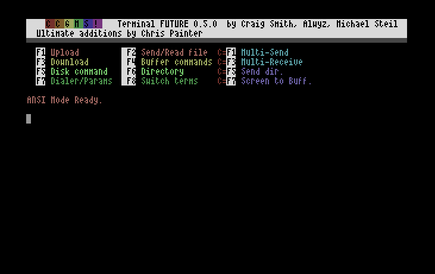
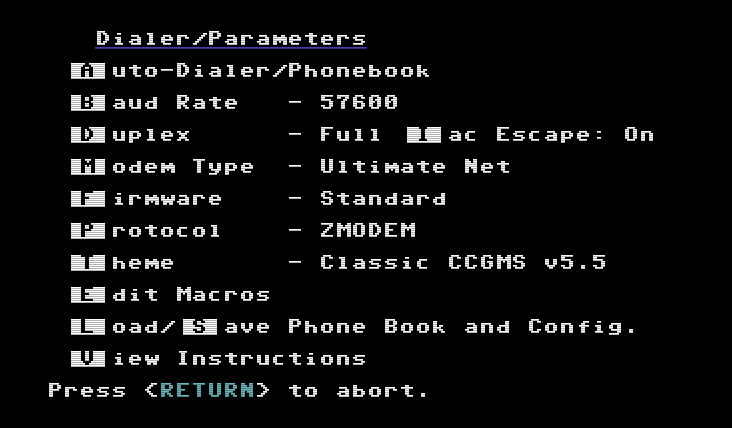
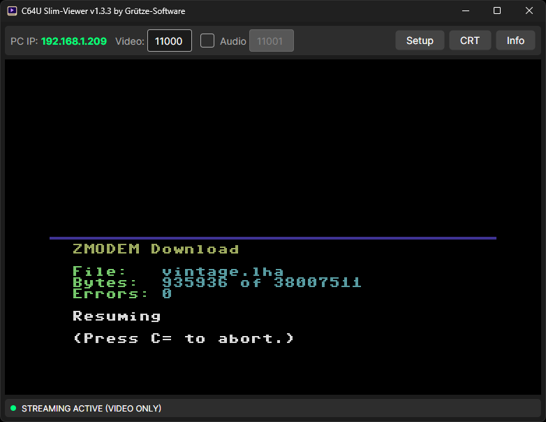
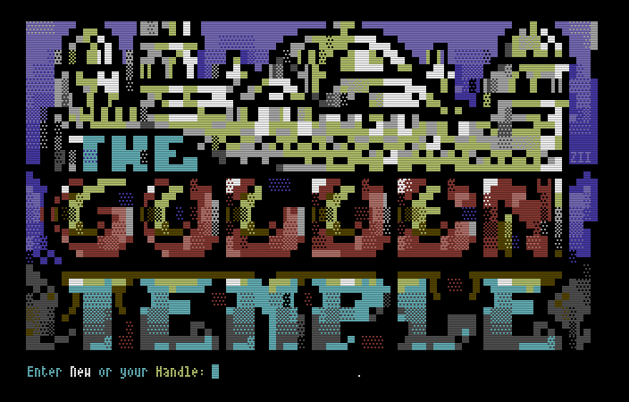
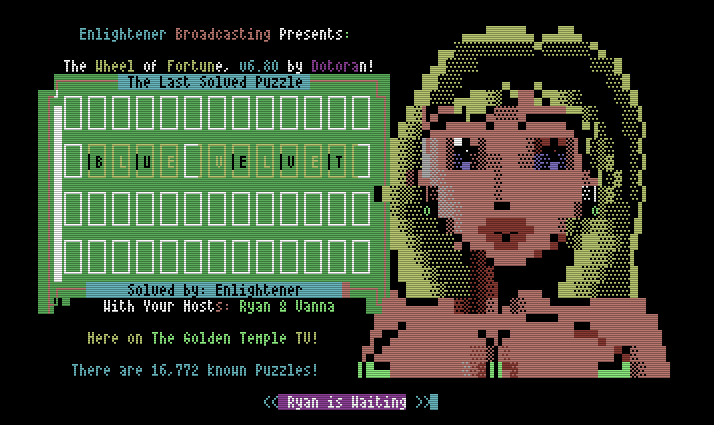

# CCGMS *Future*

*Commodore Color Graphics Manipulation System Terminal* *by Craig Smith (1985-1988), alwyz (2017-2020), Michael Steil (2022), Chris Painter (2026)*

* based on 5.5 source by [Craig Smith](https://github.com/spathiwa) 01/1988.
* 2017-2021 mods by [alwyz](http://1200baud.wordpress.com) (see [ccgmsterm2021](https://github.com/mist64/ccgmsterm/tree/ccgmsterm2021) for final alwyz version)
* fixes and additions by [Michael Steil](https://www.pagetable.com/), 2022
* Ultimate, ANSI 80 and speed additions by [Chris Painter](https://github.com/chrpai), 2026

 

## For C64 Ultimate users, this is what you get

If you have a C64 Ultimate (or an Ultimate 64 / Ultimate II+), CCGMS Future finds it on its own and lets you call BBSes over your network. No modem, no WiFi cartridge. Just turn on **Command Interface** in the Ultimate menu first.

* **Call BBSes over the internet.** Pick the **Ultimate Net** modem type and dial `ATDT host:port`.
* **Fast.** 57600 baud, quick screen drawing, and file transfers that keep up even with the CPU at 64 MHz.
* **ZMODEM downloads and uploads**, and a broken download picks up where it left off.
* **PC-style ANSI art** in an 80-column mode, as well as classic PETSCII art.
* **Telnet that just works**, so binary file transfers don't get garbled.
* **Fast Punter** and XMODEM for BBSes that use them.

**Tip:** Turn on an REU in the Ultimate's cartridge settings before you upload files. With Ultimate Net, uploads need it to be reliable. It also gives you a bigger 64 KB buffer.

## Features

* 40 column color mode
* 80 column color mode 🔴
* 80 column ANSI mode with a CP437 font, for PC-style ANSI BBSes 🔴
* PETSCII and ASCII/ANSI encoding
* Fast text output: about 1,400 B/s at 1 MHz with an REU, and tens of KB/s on an accelerated CPU 🔴
* Serial drivers (stable on NTSC and PAL 🔴)
	* User Port (300-2400 baud)
	* UP9600 (300-9600 baud)
	* SwiftLink $DE00/$DF00/$D700/NMI (300-38400 baud), 57600 on an Ultimate
	* Ultimate Net: TCP through the Ultimate's network stack, dialed with `ATDT host:port` 🔴
* Telnet support on Ultimate SwiftLink and Ultimate Net: IAC escaping, option negotiation, and terminal type `ANSI` in ANSI 80 mode 🔴
* File transfer protocols:
	* Punter, Multi-Punter (about 16,800 CPS over Ultimate Net at 64 MHz 🔴)
	* XMODEM, XMODEM-CRC, XMODEM-1K 🔴
	* ZMODEM download and upload, with resume of interrupted downloads 🔴
* Phone book with 30 entries and auto-dialer
* Configuration & phone book load/save (disk or EasyFlash)
* DOS command and directory
* Macros
* Screenshots
* Themes
* REU buffer (64 KB)

## Documentation

[CCGMS Future Documentation](Documentation.md)

## Missing Features

* [RR-Net support](https://github.com/mist64/ccgmsterm/issues/1)
* [WiC64 support](https://github.com/mist64/ccgmsterm/issues/3)
* [YMODEM](https://github.com/mist64/ccgmsterm/issues/15)/HMODEM protocols
* IDE64 compatibility
* Additional cartridges (e.g. Lt. Kernal)
* 100% support for [hardware acceleration devices](https://github.com/mist64/ccgmsterm/issues/14) (SuperCPU etc). Punter now uses real-time timeouts and works at 64 MHz on an Ultimate, but XMODEM has not had the same pass.
* Answer mode on Ultimate Net (the Ultimate firmware has no TCP listen)

## Known Bugs

* [#5](https://github.com/mist64/ccgmsterm/issues/5): XMODEM (and possibly PUNTER) transmission may be broken for UP9600 devices
* [#10](https://github.com/mist64/ccgmsterm/issues/10): XMODEM/1K may fail for SwiftLink cartridges with a real 6551 chip

## Build

Build with make & [ca65](https://github.com/cc65/cc65).

Regular build:

	make

EasyFlash build:

	make EASYFLASH=1

The EasyFlash version gives you the option of loading/saving the phonebook to cart.

In either case, the resulting file will be `build/ccgmsterm.prg`. Add `EXOMIZER=1` to also get an Exomizer-compressed `build/ccgmsterm-exo.prg`. Exomizer is a git submodule and is built from source on first use.

## Releases

Releases are made by the **Release** workflow in GitHub Actions (Actions > Release > Run workflow). Choose a semver bump (patch, minor, major, or none), or enter an exact version. The workflow updates `VERSION` in `src/ccgmsterm.s`, builds all four variants, commits and tags `v<version>` on main, and publishes a GitHub release with these attached:

| File | Build |
|---|---|
| `ccgmsterm-v<version>.prg` | standard |
| `ccgmsterm-v<version>-exo.prg` | standard, Exomizer compressed |
| `ccgmsterm-v<version>-easyflash.prg` | EasyFlash |
| `ccgmsterm-v<version>-easyflash-exo.prg` | EasyFlash, Exomizer compressed |

If `release-notes/v<version>.md` exists on main, it becomes the release notes. Otherwise GitHub generates them from the merged pull requests. The version must fit in 5 characters (for example `1.2.3`) to fit the startup header.

## Running in VICE

To run CCGMS in x64sc with SwiftLink at $DE00:

	make runsw

x64sc with User Port:

	make runup

x64sc VICE with UP9600 ([receiving OK but sending broken as of VICE 3.6.2](https://sourceforge.net/p/vice-emu/bugs/1219/)):

	make runup9600

The x64sc command line has changed recently, so these need at least VICE 3.6.

## Testing

This repository includes automated and manual tests. See [Testing](Testing.md).

## Internals

[Internals](Internals.md).

## Changelog

### 2026-11-25: Future 0.3.0

* Ultimate support (developed and tested on a C64 Ultimate)
	* Ultimate detection through the Command Interface
	* New modem type Ultimate Net: TCP through the Ultimate's network target, with a Hayes emulator so the dialer and phone book work unchanged
	* 57600 baud for SwiftLink on an Ultimate
	* IAC Escape option for telnet BBSes, with BINARY/SGA negotiation
* New 80 column ANSI terminal mode with a CP437 font. F8 now cycles PETSCII 40, ASCII 40, PETSCII 80, ASCII 80 and ANSI 80. The mode is saved in the config. In ANSI 80 mode, telnet terminal type is reported as `ANSI`.
* Received text prints about 3x faster, with REU DMA or CPU scrolling, whichever is faster
* Punter
	* fixed bad blocks above 4 MHz (timeouts now use the jiffy clock)
	* much faster over Ultimate Net: 1,895 CPS at 16 MHz before, about 16,800 CPS at 64 MHz now
	* fixed Multi-Punter receive stopping at "Waiting for header..."
* Fixed an XMODEM hang on Ultimate Net
* Versions are now semver, and releases are built by a GitHub Actions workflow

### 2022-03-20: Future 0.2

* Added support for a software 80 column screen mode
	* F8 now cycles: 40c PETSCII -> 40c ASCII -> 80c PETSCII -> 80c ASCII
	* All menus, transfers etc. temporarily switch back to 40 col screen. The 80 column contents will be preserved when temporarily switching.
	* In 80 color ASCII mode, the characters <tt>\^_`{|}~</tt> are available, matching ASCII (unlike 40 col ASCII).
* Fixed ASCII-PETSCII conversion of codes 0x60 and 0x7B
* Changed some wording to be clearer (imho):
	* "Graphics" and "C/G" to "PETSCII"
	* "Anscii" to "ASCII"
	* "Author's Message" to "Instructions"
* Internal changes
	* rewrote RS232 driver model
	* cleaned up code memory layout

### 2022-02-25: Future 0.1

* Fixed timing for PAL in User Port and UP9600 drivers
* Implemented XMODEM-1K
	* protocol XMODEM-1K forces 1K on upload
	* any XMODEM protocol will accept 1K blocks on download
* XMODEM-CRC autodetect on upload
	* protocols XMODEM-CRC/-1K will force CRC on download
	* any XMODEM protocol will accept CRC on upload

### 2020-12-08: v2021 final
* Punter stack and Unlisted dialer bugs have been eliminated
* Support in autodialer for Zimodem and related WiFi device firmware that prefer an ATD prefix to ATDT.

### 2020-09-22: v2021 pre-beta2
bo zimmermans firmware (and maybe others) take issue with atdt, and prefer using atd instead for bbsing (uploads/downloads issue). hopefully this  is the only issue with firmware compatibility. willing to solve this issue on the software side, though i'd prefer firmware uses a better standard. but fuck it, it's 2020 and who gives a shit anymore about standards on an 8 bit computer from the 1980s? so i added an atd/atdt menu option

### 2020-06-30: v2021 beta 1
* doing some bugfixing. dial unlisted doesnt restore bottom of screen after dial. now it does. cosmetic fix.
* abort punter crashes stack pointer because i bypassed jump table and apparently that is neccessary so its back in the calls from dowmen and f3 routines.

### 2020-05-23: v2020 beta 8
* easyflash false positive with reu detect. since ef and reu cant work together, added provisions at startup to prevent easyflash mode from even looking for an reu

### 2020-05-21: v2020 beta 7
* did some tweaks to autodialer. try counter now works to 99, and dial unlisted had some weird issues with that so that has been sorted as well.
* found one bug in the bottom screen display routine which has probably been there since ccgms 2017, but its good now.

### 2020-05-19: v2020 beta 6
* merged easyflash version into this one. only added 2 blocks. easier for maintaining
* still have some room from $5000-$5100 for more code/routines if need be. And can always add more code at $5c00 before the end

### 2020-05-18: v2020 beta 5
* fixing some possible issues with multi-upload. crashes between files. enablexfer not getting turned back on at the right time?
*  re-did cf1 multi-upload enable/disablexfer calls... seems good now

### 2020-05-17: v2020 beta 4
* found a bug on the original punter sourcecode that incorrectly references var "delay" as delay 1 on 0 off, but in truth it is 1 off 0 on, so ive set both to delay on now update... ahh fuck it, no matter what, add delays every chance we can.... i disabled every opportunity to bypass delay around pnt106.

### 2020-05-16: v2020 beta 3
* f3 disablexfer improvements
* multi-receive disablexfer imrovements / trying to prevent crashing on multidownloads (noted on up9600)
* added punter handshake delays from ultimate version back in. baudrates faster than 2400 are definitely having problems with handshakes so its back!
* added jsr call to rsopen to baudrate changer. see if that fixes some weirdness

### 2020-05-14: v2020 beta 2
* first public beta. rewrite of pretty much everything....
* file transfers finally incorporate flow control. they never did before.
* resetvectors removed.
* re-wrote and optimized all modem drivers.
* removed a bunch of spaghetti code of my own making...

### ultimate version
* 2019 by alwyz

### version 2019
* 2019 by alwyz

### version 2017
* 2017 by alwyz

### Historic Versions
by Craig Smith

* version 5.5 -- jan 1988
* version 5.0 -- jan 1988
* version 4.5 -- may 1987
* version 4.1 -- oct 1986
* version 4.0 -- date unknown (mods by greg pfoutz,w/permission)
* version 3.0 -- aug 1985
